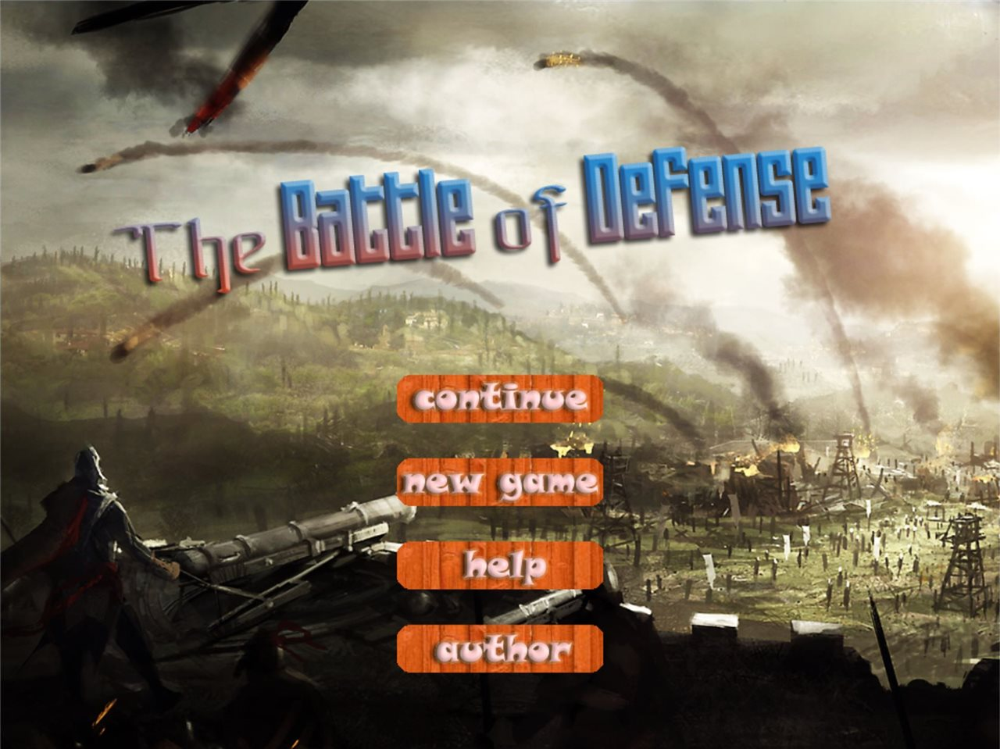

# Defense 3D

A simple 3D game built with C++ and OpenGL ES 2.0.

## Build and run

1. Install Visual Studio 2022 with **Desktop development with C++**, MSVC v143 and a Windows SDK.
2. Open `DefenseProject.sln` and set **Defense** as the startup project.
3. Select **Debug | Win32** or **Release | Win32**, build and press **F5**.

The required EGL/GLES DLLs are copied automatically. Keep `Resources/` beside the output folder.
